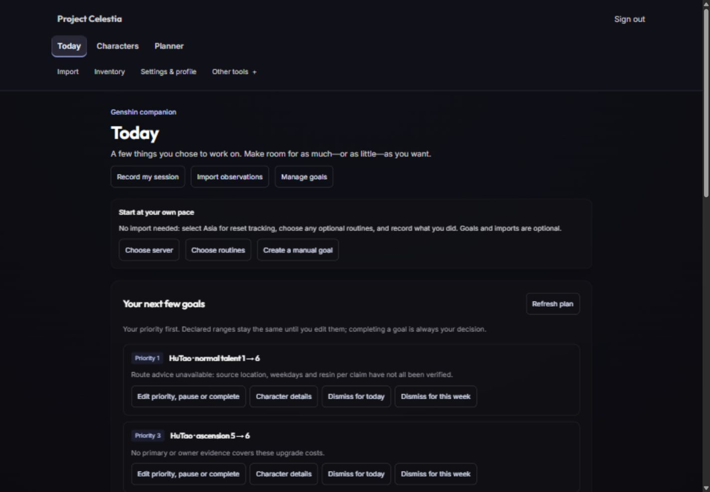

# C5 companion journey and local beta assessment

Completed bounded implementation and local verification on 2026-10-09 in `D:\Genshin Personal\project-celestia`. **Functional local acceptance passed; full accessibility and beta/release readiness remain qualified by the open checks below.** The tree is intentionally uncommitted. No deployment, invitation, catalog expansion or C6/C7 work was performed.

## User-visible changes

Today, Characters and Planner now share persistent navigation and active-location cues. Import, Inventory and Settings & profile stay visible; Other tools retains every secondary route. The layout supplies a skip link, route focus, native secondary disclosure with Escape/outside dismissal, and direct anchors to the existing server/routine forms. No new settings database or onboarding state was added.

Today explains how to start without importing. Characters adds URL-preserved search/focus filtering, a distinct no-results state and deliberate refresh. Settings & profile links to the existing controls. Inventory and equipment remain observation-based, with mobile wrapping and honest unknown assignment/provenance. Partial imports preserve declared intent and omitted equipment. Secondary legacy scores and simulator assumptions are qualified without changing their algorithms.

Failed refreshes retain labeled confirmed records; empty and unavailable states remain distinct. A discovered Today refresh bug previously announced success after an invalidation even if the fetch failed. It now checks the actual refetch result and retains drafts on failure. Query callers pass AbortSignal through the existing originating-session guard. Endgame keeps a stable main element when loading completes so keyboard focus is not lost. Scoped styles improve target sizes, focus/contrast and narrow layouts, remove perpetual pulse/spin and honor reduced-motion CSS without altering the three protected baseline style/HTML files.

## Validation and evidence

- Re-established C4 before edits: **691 tests / 43 files / 106 PostgreSQL cases**, zero failed/skipped.
- Final complete direct suite: **708 tests / 44 files / 106 PostgreSQL cases**, zero failed/skipped, 107.88 seconds. Seventeen new tests exercise actual navigation rendering, URL filters, retained/unknown states, cancellation and session rejection. Existing reset-lock, lifecycle, rollback, ownership and import integration cases all ran.
- API lint/build, shared contracts TypeScript, web lint/build, guarded Prisma validation and schema diff passed. Focused formatting and diff checks are recorded in [validation-results.json](validation-results.json). No schema/contract/dependency change. The inherited PostgreSQL overlapping-query deprecation remains visible; Prisma's update notice was informational and no update was made.
- [Acceptance](acceptance.md) records the ten scenarios, controlled daily/weekly resets, two-owner delayed requests, deep equality before/after partial import, actual failed-save/conflict/manual recovery, all route entries and rendered 1440/390/320 checks. [Route/caller audit](implementation_plan.md#routecaller-matrix-and-navigation-decisions) was persisted before coding.
- [Preservation](preservation-check.json) compares the inherited source baseline, eight protected files, all thirteen migrations, five formatter exceptions, HEAD and empty index. It also records ordinary build/browser restoration and owned-service shutdown.

## Limits and remaining prerequisites

Selected Asia remains the only enabled reset server; only HuTao base talents 1–6 have verified costs; every production farming route remains unavailable. Focus, declared ranges, priority, explicit lifecycle/history, unknown stock, manual records and section receipt meanings are unchanged. No import or observation automatically completes goals.

The tool supported viewport reflow and keyboard inspection, but did not apply real browser zoom or emulate the OS reduced-motion preference. CSS/media rules and zero perpetual Today animations were inspected; actual 200%/400% zoom, OS reduced-motion behavior and screen-reader experience remain unverified. Do not describe this as full accessibility sign-off or real-player usability. Secondary entry pages were checked, not every legacy modal/algorithm workflow.

The [readiness table](beta-readiness.md) identifies missing/unverified backup and restore evidence, exposure/abuse controls, account export/deletion/recovery handling, named data upkeep ownership, complete CI/cutover evidence and the still-unverified Render SHA. It assigns concrete next actions, without making production changes. The [voluntary usability script and blank template](usability.md) contain no fabricated participants/results. Operational/accessibility prerequisites and separately authorized human beta feedback remain gates; C6/C7 do not begin automatically.

Temporary fixture controls were cleared, browser sign-in/viewport were cleaned up, the ordinary web build restored, and only the owned local services stopped. The existing dirty master checkout, protected history, package manifests and lockfile are preserved. Review this bounded implementation and remaining evidence before any separately authorized release action.
