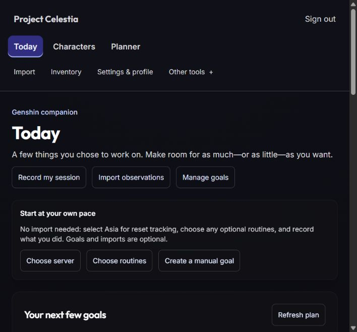

# C5a reproducible verification and origin hardening

Completed the bounded local milestone on 2026-10-10 in the owner-authorized
`D:\Genshin Personal\project-celestia` checkout. **Local implementation passes.
Remote CI has not run. Beta/release prerequisites remain open.** These conclusions
are independent. Work remains uncommitted and unpushed; no branch/worktree change,
normal database access, deployment, invitation or C6/C7 work occurred.

## Findings resolved

| C5 finding                                                                                      | Change                                                                                                                                                                                                                                                          | Actual regression/evidence                                                                                                                                                                                                                                                                                                                                                              |
| ----------------------------------------------------------------------------------------------- | --------------------------------------------------------------------------------------------------------------------------------------------------------------------------------------------------------------------------------------------------------------- | --------------------------------------------------------------------------------------------------------------------------------------------------------------------------------------------------------------------------------------------------------------------------------------------------------------------------------------------------------------------------------------- |
| R1: CI used a placeholder/Turbo path, incomplete environment and only two integration files     | Root `pnpm run verify` invokes a source-guarded portable helper; CI uses the same command after frozen installation and an isolated PostgreSQL service. Contracts build first, database readiness precedes migration, and real result evidence gates success.   | Reproduced old guard rejection; unsafe ordinary-database invocation exits 1 before any child command. 33 helper regressions cover safe order, absent/mismatched/unsafe targets, enabled dotenv, failing readiness/migration, skipped/missing/duplicate evidence, additions and preservation. All six actual PostgreSQL suites ran.                                                      |
| R2: substring CORS admitted attackers/unrelated previews and rejected ordinary origins with 500 | Focused config and middleware parse exact HTTP(S) origins; production requires an explicit valid allowlist. Documented local defaults, deliberate 403, Vary, preflight and absent-Origin behavior. Cookie credentials omitted; bearer authentication unchanged. | Reproduced four reflected untrusted origins and the old 500. 58 actual-Express/config tests cover configured and local origins, attacker/preview lookalikes, schemes/ports, malformed/null/absent origins, all required preflight methods/headers, invalid production startup, required secrets and protected read/write/self-only access. Real browser and loopback HTTP smoke passed. |

The [runbook](runbook.md) records exact commands, origin syntax, startup failure
behavior and frontend/API coordination. No production domain was guessed.
`env.ts`, `.env.example`, the API manifest and disposable guard remain byte-identical.

## Verification

The verified existing fixture belongs to `NITRO\inuzu`, uses PostgreSQL **18.4**,
and has absolute data directory
`C:\Users\inuzu\AppData\Local\Temp\celestia-c4-6d547b9077534faa9ea7871b1017b2f6\data`.
Before restart, its recorded command line/version/owner were inspected and port
55448 was closed. Only that owned instance was restarted on 127.0.0.1:55448.
Both the existing disposable administrative connection and fresh target were
guarded before creating `celestia_test_c5a`. The first entry-point run applied all
thirteen existing migrations to the empty database. No new migration was added.

- Final `pnpm run verify`: **799 passed / 46 files / 106 PostgreSQL cases**, zero
  failed/skipped/todo, **67.87 seconds for Vitest**. This adds 91 tests to 708/44.
  Plan 28, lifecycle 28, routine 12, equipment 13, importer 16 and catalog 9.
  [Console log](verification-run-2.log), [actual JSON report](test-results.json),
  [entry-point step results](entrypoint-results.json).
- Shared-contract types/build, API lint/types/build/static copy, web lint/types/
  production build, guarded Prisma generation/validation/schema comparison,
  repository formatting/integrity and diff check passed. The schema diff reported
  no difference. The final run exercised idempotent migration deploy after the
  first run's successful fresh-chain application.
- [Unsafe entry point](unsafe-entrypoint.log) exited 1 before any `CHECK` command.
  The guard is reused unchanged; missing configuration never falls back to `.env`.
- Workflow YAML parsed with unique-key checks using installed tooling. Matching
  job environment, PostgreSQL health service, pinned installed Node/pnpm, frozen
  install, shared entry point and artifact upload were inspected. This is local
  structure evidence, **not an executed Linux/GitHub workflow**.
- Inherited pg overlapping-query deprecation, Prisma update notice and Git CRLF
  warnings remain visible. No dependencies were changed or warnings suppressed.

The first focused run had one assertion error: it expected 403 for a foreign user
ID, while the preserved anti-enumeration contract correctly returns 404. The test
was corrected; no auth behavior changed. The first full run passed 794/46/106 and
then correctly failed formatting on seven raw C5 JSON captures. Both unsuccessful
attempts remain in the logs rather than being reported as green.

## Historical formatting evidence

The five inherited formatter exceptions retain their exact hashes. The full
repository check additionally discovered seven unformatted machine-captured C5
JSON artifacts. Rewriting them would invalidate historical byte evidence, so
`raw-evidence.json` lists precisely those seven paths/hashes for mandatory JSON
parse and byte-integrity checks. Prettier covers all other relevant files, including
historical documentation; no source tree or documentation directory is excluded.
This separate raw-data check is explicit, not a claim those files pass Prettier.

Exact `.gitattributes` entries prevent newline conversion for these twelve files.
The original Sonnet submission and C5 raw starting-state capture contain CRLF.
[Clean-filter identity checks](git-byte-preservation.json) verified all twelve
without staging or creating a checkout. No historical hashes/results were rewritten.

## Browser and live API smoke

The new guarded `origin-browser-fixture.mjs` seeds only the synthetic
`c5a-smoke@test.invalid` account and serves the **actual app** on 127.0.0.1:45448.
Its explicit allowlist is `http://127.0.0.1:45449`; Vite preview serves the built
frontend there. Unlike the older journey fixture, it adds no wrapper CORS layer
that could mask the application's preflight behavior.

Real browser login succeeded and [Today](smoke-today.txt) loaded the empty plan,
unknown resin and no-import guidance. A materials-only GOOD payload reached
[Review your changes](smoke-import-preview.txt): materials replace one entry,
characters/weapons/artifacts preserved. The preview was not committed. The
[profile read](smoke-profile.txt) returned only the synthetic account. Browser
console error inspection was empty. [Ten supplementary HTTP probes](http-smoke.json)
confirmed allowed preflight 204, login/authenticated read 200, unauthenticated
read 401, attacker/null origins 403, no-origin health 200, Vary and no credential
header. Tokens were not retained in evidence.

The first uppercase-label selector did not match DOM title-case labels; a fresh
snapshot resolved it. Full-page screenshot capture was unavailable; the supported
viewport screenshot was saved above. A background-launch attempt was blocked by
automatic tool review; foreground tool sessions successfully ran the same owned
services. Work resumed after an interruption without replacing the fixture or
opening another checkout.

The account was signed out, the created tab closed and no viewport/zoom/OS setting
changed. The ordinary production web build was restored without the local API
override. Only the created API/web sessions and restarted owned PostgreSQL instance
were stopped. Ports 45448, 45449 and 55448 were verified closed. [Cleanup](cleanup.json).

## Preservation, review scope and remaining gates

[Preservation](preservation-check.json) records all eight protected files, thirteen
migrations, five formatter exceptions, all inherited source/evidence hashes,
unchanged HEAD/master and empty index. Existing C1–C5 reset/owner-lock/revision,
atomic response/session, import/intent/history, unknown-stock and narrow-catalog
contracts remain covered by the full suite. All production farming routes remain
unavailable; no product-flow, schema, contract or dependency change was introduced.

Review `.github/workflows/ci.yml`, root `package.json`, `.gitattributes`, the
`app.ts` wiring, new `core/config/cors.ts`, `core/middleware/origin.middleware*`,
`tooling/verification*`, `tooling/verify.mjs`, `tooling/raw-evidence.json`,
`tooling/origin-browser-fixture.mjs`, and the C5a documents. Only the handoff and
roadmap checkpoints were updated outside that slice; the changed-file manifest
distinguishes this work from the intentionally dirty inherited checkout.

[Remaining gates](beta-readiness.md) specify next evidence and person/provider
actions: actual remote CI and deployed SHAs, configured exact deployed origins,
backup/restore drill, abuse controls, recovery/export/deletion processes, named
data upkeep, coordinated cutover, actual zoom/reduced-motion/assistive checks and
authorized real-player validation. No owner, human result or recovery drill was
invented. CORS does not close those gates. Stop here; product expansion is not
authorized by local C5a completion.
