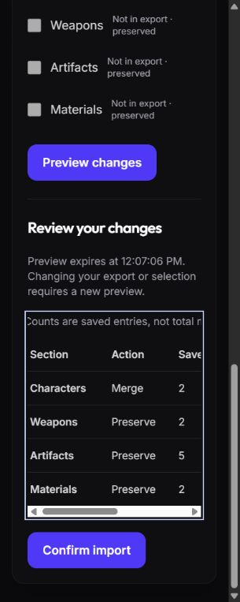

# C5e measured acceptance — October 14–15, 2026

Synthetic local browser execution, not participant feedback or an accessibility
certification. The preserved C5d harness ran against the owned C5c review cluster.
API: `127.0.0.1:45448`; web: `127.0.0.1:45449`. No normal database was used.
Chrome default viewport measured 1036×695, DPR 1.25. Narrow overrides were 320×800.
Final checks used the Chromium in-app browser after Chrome blocked automation on
an open extension panel. Inputs combined semantic fill/select/check actions with
actual Enter, Space, Tab, Escape and arrow-key activation; this was not an entirely
unassisted keyboard-only or screen-reader session.

## Reproduced defects and resolutions

| Failure before correction                                                                                                                         | Change                                                                                                                                                         | Measured result                                                                                                                                                                                                          |
| ------------------------------------------------------------------------------------------------------------------------------------------------- | -------------------------------------------------------------------------------------------------------------------------------------------------------------- | ------------------------------------------------------------------------------------------------------------------------------------------------------------------------------------------------------------------------ |
| Goal Add/Edit left focus on the opener; edit form appeared earlier in document order. Cancel and successful save left BODY active.                | GoalManager focuses the first enabled form control and returns to the connected opener, falling back to Add goal. Saves announce confirmed state.              | New form SELECT, range editor enabled from INPUT, priority editor SELECT; cancel returned to exact edit button; priority save returned to Edit priority only and showed priority 2.                                      |
| Duplicate goal rejection left an entered draft; cancellation after the first focus patch incorrectly refocused the old error.                     | Focus failed-save alert, retain draft, clear editor error on cancel. Successful refresh uses status rather than error.                                         | Real duplicate intent rejection kept HuTao / 1 / 6; alert received focus; final cancel removed the alert and returned to Add goal. No duplicate was saved.                                                               |
| Import preview had no focus destination or status announcement; preview/commit/restart left BODY active.                                          | Focus review/completion headings, parse/server error, and restarted JSON input.                                                                                | Invalid JSON focused alert. Preview focused H2; Tab reached review controls. Commit focused Import complete; restart focused good-json.                                                                                  |
| At 320px the preview table was technically within the page but split Section/Characters/Action into fragments. Section checkbox names also split. | Readable minimum table width in labelled focusable horizontal region; preserve checkbox name width.                                                            | Table 448px inside 231px region; document client/scroll both 305px. Tab entered region and ArrowRight moved scrollLeft 0→40. Confirm import remained reachable. See screenshot.                                          |
| Resin/plan save disabled or replaced the active control, leaving BODY active.                                                                     | Remember initiating control; restore only when focus was lost to BODY, after saving/refetching; session-check and fall back to refresh/disclosure when needed. | Resin save returned to Record resin. Remounted choices form returned to Plan choices · 70 resin / day; final fixture repeated with 71.                                                                                   |
| Sign-in lacked a main landmark and sat outside existing scoped focus/motion styling.                                                              | Use main with companion-shell and a sign-in document title.                                                                                                    | One main; title Sign in · Project Celestia; 320px client/scroll both 320px. Wrong password announced Invalid email or password, and corrected credentials signed in. Reduced-motion behavior itself remains unperformed. |
| Character page retained loading title Character equipment after H1 became Hu Tao.                                                                 | Observe heading changes without moving focus.                                                                                                                  | Loaded title Hu Tao · Project Celestia, main focus retained; repeated on returning account after import.                                                                                                                 |

## Core journey results

| Check                                 | Result and evidence limits                                                                                                                                                                                                                                                                                                                                                                           |
| ------------------------------------- | ---------------------------------------------------------------------------------------------------------------------------------------------------------------------------------------------------------------------------------------------------------------------------------------------------------------------------------------------------------------------------------------------------- |
| No-import first use                   | PASS. Empty owner selected Asia, enabled daily commissions, recorded resin 80 then 81 and checked commissions. Unknown weekly count stayed distinct from zero. No import required.                                                                                                                                                                                                                   |
| Support boundaries                    | PASS for visible copy. Asia-only resets; manual records/estimates are not game sync. Planner states only HuTao base talent 1–6 costs and no production farming routes. Equipment distinguishes unknown assignment from an empty game slot.                                                                                                                                                           |
| Manual goal and focus                 | PASS. Empty owner created normal talent 1→6, changed priority 3→2, later imported HuTao and added focus. Goal remained active and declared range unchanged. Ascension goal also stayed active despite stored ascension 6.                                                                                                                                                                            |
| Import                                | PASS. Actual preview and explicit commit of synthetic character-only GOOD payload; omitted inventories preserved. Final populated owner retained StaffOfHoma, five artifacts, focus, completed/active/paused/archived goals and independent old equipment receipts. [Captured final DOM](returning-character.txt).                                                                                   |
| Failed save and recovery              | PASS for actual duplicate-goal rejection, draft retention, alert focus and cancellation; valid priority save independently passed. Existing client/database suites cover session and conflict behavior. This phase did not inject a new 503/offline transport failure or repeat every C5 pending-owner race in the browser.                                                                          |
| Goal lifecycle                        | PASS. Exact linked goal paused then resumed at 320px. No automatic completion inferred from imported progress.                                                                                                                                                                                                                                                                                       |
| Navigation/back/forward/reload        | PASS. Search Hu + focus encoded in roster URL; Back restored both; Forward returned to equipment. Direct route reload exercised for import and linked Planner. Lazy-route transient selector attempts were retried only after fresh state inspection.                                                                                                                                                |
| Keyboard focus                        | PASS for exercised controls. Settings export/deletion review focused current password; Cancel returned to trigger; deletion remained disabled without credentials and exact phrase. No account was deleted during C5e browser work. Skip link focused companion-content; Other tools Enter/Escape closed and returned to summary with visible rgb(199,210,254) outline (1.6 CSS px at measured DPR). |
| Narrow reflow                         | PASS at 320×800 for Today, Characters, detail, Planner, Import, Inventory and Settings: document client/scroll widths 305/305 with scrollbar. Sign-in 320/320. Import table deliberately scrolls inside the page. Sample screenshots visually inspected; not an exhaustive contrast/target-size audit.                                                                                               |
| Actual 200%/400% zoom                 | UNPERFORMED. Chrome Control+plus left innerWidth 1036 and DPR 1.25 unchanged; Control+0 was sent. Browser capability exposes viewport, not zoom. A later Windows-helper attempt was blocked twice by native user-input conflicts before changing zoom. Resizing is not counted as zoom.                                                                                                              |
| Reduced-motion preference             | UNPERFORMED. Existing scoped rule now includes sign-in. The browser tool has no motion emulation; native interaction could not proceed reliably during the later zoom attempt. No OS preference was changed. CSS inspection is not execution under reduced motion.                                                                                                                                   |
| Human assistive technology/usefulness | UNPERFORMED. No screen reader, human task timing, comprehension observation or participant contact. Use owner-walkthrough.md.                                                                                                                                                                                                                                                                        |

## Execution interruptions and cleanup

The first noninteractive harness run (`celestia-recovery-n86g3S`) reached ready,
then EOF caused normal successful cleanup. Interactive run `celestia-recovery-Y4qSIJ`
provided the initial and most fix checks; interruption killed its processes before
finally-cleanup. Its exact lease, dead PID, system identifier, tablespace directory
and OID 29563 were reconciled with `cleanup-interrupted.mjs`. Ordinary PostgreSQL WAL
recovery started that owned cluster; guarded cleanup removed only this run's
database/role/tablespace and stopped the newly verified process. No catalog repair,
force drop or recursive deletion occurred. A first invocation used a wrong relative
script path and failed before running; the corrected path succeeded.

Final browser run `celestia-recovery-SFa3PO` reused the unchanged guarded harness.
Its result confirms resources removed, owned PostgreSQL stopped, ordinary web build
restored and browser ports closed. Chrome blocked automation after an extension UI
opened, even after the owner's initial ready response. Final checks continued in an
in-app tab. That tab was reset and closed by tool; the owner explicitly confirmed
closing the remaining Chrome synthetic tab after tool cleanup was blocked. Chrome's
temporary viewport reset was not independently observed; closing the owned test tab
was owner-confirmed. No OS preference was changed. Private raw directories remain
outside Git; their existence does not mean fixture services remain running.

A final native-helper attempt used a new guarded run, celestia-recovery-wuAdPs, after the passing full verification. The Windows helper was available, but repeated user-input conflicts blocked native zoom/menu input. No actual zoom or motion change was established. The owned Chrome tab was subsequently closed and viewport reset successfully through the browser tool. That harness was sent quit for ordinary cleanup; cleanup.json records the confirmed result. This added evidence does not change application code or justify repeating the passing suite.
