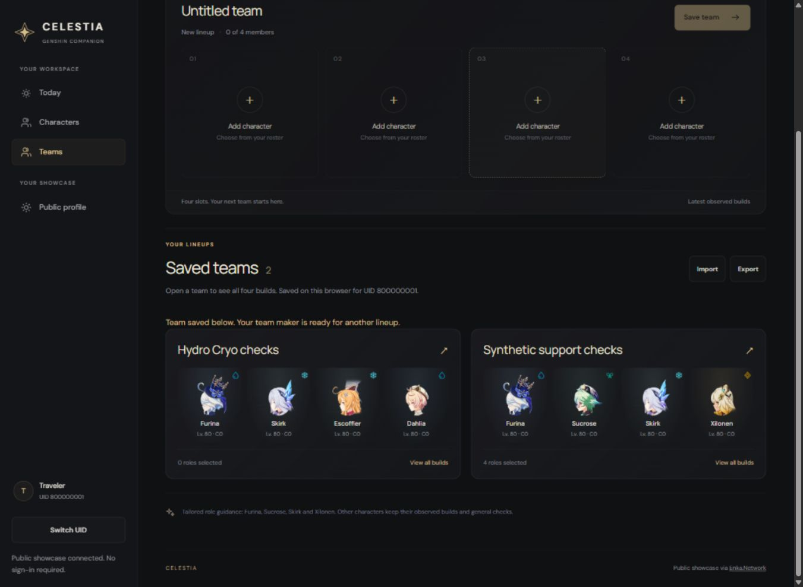
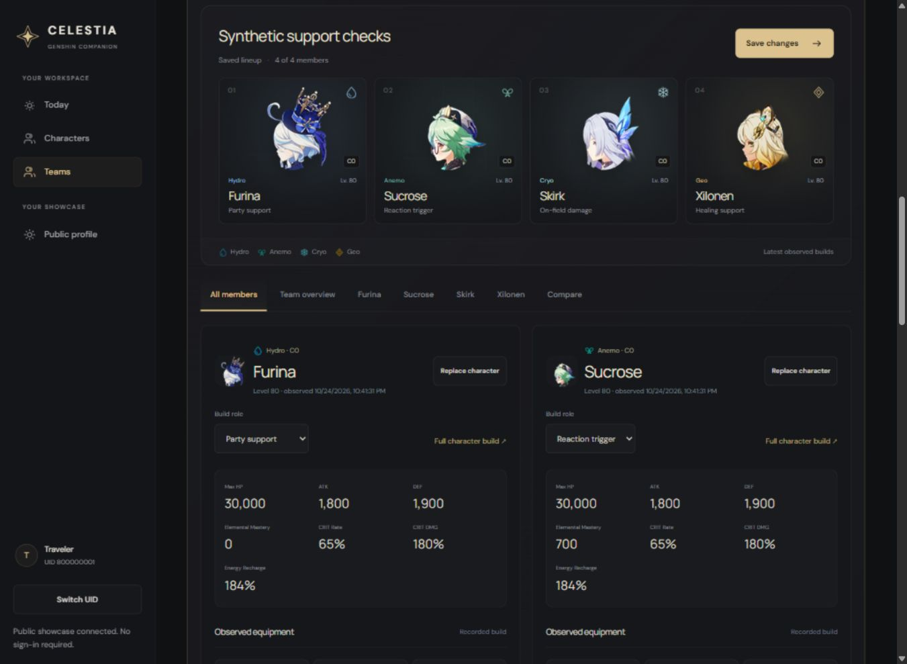
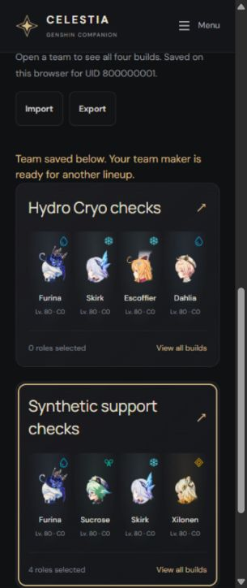

# Saved-team gallery update — 2026-10-24

Owner request: remove the header New team action and saved-team dropdown; keep a team maker above a compact collection, fit two saved teams per desktop row, and expand a clicked team to show all four builds.

The page now keeps an independent maker above Saved teams. Choosing four characters and saving adds a collapsed portrait card, clears the maker for another lineup, scrolls to the collection, announces success and focuses the new card. Existing version-1 IndexedDB teams appear directly as cards; storage schema, UID scoping and import/export format are unchanged.

Cards show the team name, four character portraits, levels/constellations and role count. Desktop uses two columns; small screens use one. Opening a card expands it across the row and defaults to All members, rendering all four build details together. Focused member tabs, overview, comparison, rename/save, duplicate-to-maker, delete and return deep links remain available. The maker stays independent while a saved team is opened or edited. Only the expanded team's detailed editor is mounted. Unknown/missing member records preserve membership and offer replacement.

`TeamBuildEditor.tsx` extracts the shared editor from the page, with per-editor tab ID prefixes to avoid duplicate ARIA references. The page manages the saved collection, expansion URL and import/export. Calculators and persisted team records are unchanged.

Verification: **128/128 tests across eight files**, web production build/typecheck, full web lint, scoped tooling lint, formatting and diff whitespace checks pass. Updated React/real IndexedDB tests cover existing-team load, all-four expansion/collapse, maker independence, edits saved explicitly, save-to-card/maker reset/focus, preservation of existing teams and UID isolation.

Actual browser flow on an isolated synthetic origin selected Furina, Skirk, Escoffier and Dahlia using the real picker, named/saved the team, and confirmed a second compact card with an empty maker. Two desktop cards share a row. Enter expands a card, four member-detail regions are mounted, and DOM IDs remain unique. Reload retains both teams. At 390px and 320px the page has no horizontal overflow; the gallery becomes one column. No synthetic team was saved on the production origin.

Evidence uses synthetic builds:

The owner previously authorized committing and deploying this ongoing feature. Release target remains https://projectcelestia.vercel.app/u/860507835/teams via the existing Git-connected Vercel production project. Release receipt and exact deployment identity are recorded separately after publication. The original messy checkout and inherited scratch data remain preserved.
