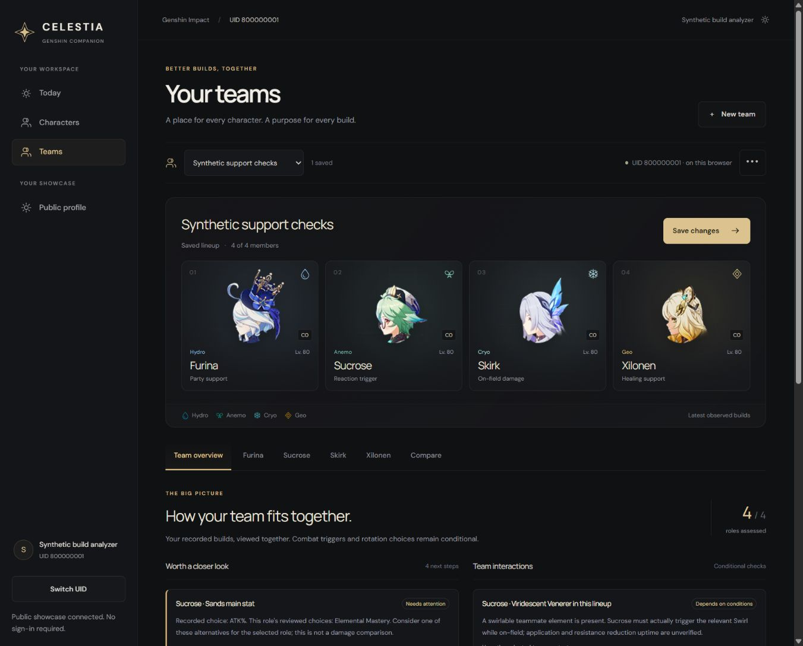
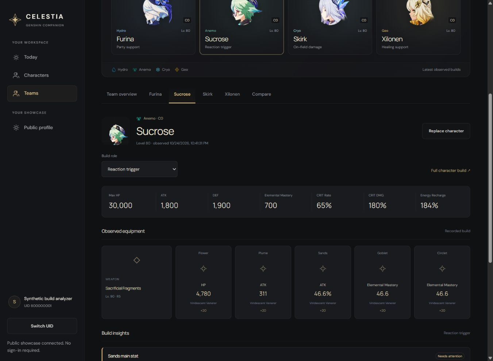

# Public character and team analyzers — local implementation

Completed 2026-10-24. Continued the interrupted Claude work, then redesigned Teams at the owner's request using the Genshin Optimizer member-tab structure and Celestia's existing charcoal/ivory/gold visual language.

## Open this preview

**http://127.0.0.1:45761/u/860507835/teams**

- Source directory: `D:/Genshin Personal/celestia-build-analyzers`
- Branch: `claude/public-build-analyzers`
- Base/HEAD: `e8f6a95c319a8621c0524ff2947550c644a2d1b3` (production frontend baseline; changes remain uncommitted).
- Vercel production inspected as deployment `dpl_BzNfYVw1eU5b5MuKghcSzPmhomQ7`. This does not establish the separately hosted Render backend SHA.
- Preview frontend: port 45761. Public showcase API: port 45750, using the committed standalone showcase server with synthetic/unreachable database settings. No private login or database connection is needed.
- Real UID 860507835 resolves to Arima and 12 public showcase characters. The preview was switched back to the real public API after synthetic verification. Synthetic observations/teams were never seeded on the production origin or this real UID.
- Temporary mutation verification ran on a separate local origin, ports 45771/45760, UID 800000001. That QA pair was stopped after verification; it is not another user preview.

The messy `D:/Genshin Personal/project-celestia` source tree was preserved. Implementation stayed in the existing production-based Claude worktree. Its inherited `.scratch` files, `relic-items.json`, and original equipment generator match the recorded pre-continuation hashes. The inherited draft adapter/types/identity code was intentionally completed or corrected. No staging, commit, push, PR, migration, production write, or deployment occurred.

## Delivered behavior

The public character detail page now has explicit role selection, optional saved-team context, linked references, prioritized next steps, complete supported checks, and an isolated main-stat/set assumption comparison. Existing observed statistics, gear, talents, retained builds and character presentation remain available. Combat totals are never recomputed from hypothetical equipment.

Teams has four portrait slots, a searchable element-filtered character picker, editable team name, saved-team selector and local save/import/export/duplicate/delete controls. Duplicate playable forms, including the two Traveler variants, are prevented. Partial lineups remain usable drafts; saving requires four members. Desktop and mobile navigation include Teams.

Team overview aggregates member next steps and conditional interactions. Member tabs show the recorded build, equipment, role selector and the same shared analysis used by the standalone page. Compare captures an original lineup and one candidate replacement from the same frozen source records. It never changes the saved lineup. Full-build and return links preserve saved team context when the current draft matches it.

Saved teams use a separate versioned IndexedDB database scoped by UID. Import is bounded to 200 KB, validates roles/forms/schema/UID, and atomically refuses conflicting IDs, corruption, storage failures and the 100-team limit. Existing retained observations and account storage are not repurposed. Browser-local teams are not cross-device storage or proof of ownership.

## Actual coverage and limits

Rule pack `public-build-analysis-1` has reviewed role patterns for **Furina, Sucrose, Skirk and Xilonen**. Furina and Xilonen C6 patterns fall back to general checks because those constellations change the modeled scope. Other kits retain observations, equipment compatibility and explicit coverage gaps; they do not get inferred recommendations. See [source review](sources-review.md).

The deterministic calculator emits typed findings; a separate explainer supplies text. Source manifest hashes and separately accepted hashes gate affected profiles. Acquisition does not automatically accept an updated guide. This is a pinned review workflow, not runtime upstream monitoring. Stable equipment lookup covers 4,320 artifact item IDs, 65 set identities and 252 weapon identities; unreviewed IDs stay unknown. Localized labels are never identity keys.

Modeled team prerequisites: Skirk's Hydro/Cryo-only party Skill-level bonus with both elements present; Xilonen's two PHEC teammate support prerequisite; Sucrose's four-piece VV with a swirlable teammate element; and Skirk's reviewed Hunter/Furina option. Presence never proves activation, uptime or a rotation. The Skill-level bonus is not added again to observed talent values. Full Hunter stacks and the relevant rotation remain assumptions.

No exact damage/rotation/energy simulation, universal quality score, optimizer search, automatic gear changes, full private roster, historical loadout manager, or exhaustive modern-kit coverage is included.

## Verification

- **126/126 tests across eight files passed.** This includes 19 engine, eight IndexedDB, three React Teams integration, six retained-roster, 12 UID workspace, 26 showcase client, 51 showcase service and one public HTTP tests.
- Final copy/UI adjustments were followed by another 15/15 Teams + UID workspace integration pass.
- Contracts build, API production build and web production build passed. Web build includes TypeScript checking. Full web lint and scoped new API tooling lint passed. Changed/new implementation files were formatted and checked.
- Fixtures cover ratio/percentage-point conversion, unknown/zero/null distinctions, explicit main stats, base/unknown bonus talents, duplicate-slot bounds, stable identities, valid alternatives, unknown source/constellation scope, deterministic standalone/team agreement, positive/negative/unknown context, all-Cryo Skirk rejection, mixed times, malformed keys/roles and no mutation of observed input.
- Actual browser checks used the real React app, public-route fixture, production calculator/explainer and real browser IndexedDB. Verified save/reload, actual file export/import, missing references, role drafts, member links/return, comparison isolation, picker search/element filters/duplicate prevention, Escape focus restoration, keyboard tabs, and desktop/390px/320px layouts without horizontal page overflow.
- The redesigned picker was exercised at 320px. An unsaved Sucrose → Escoffier replacement was discarded by reload; the saved Sucrose lineup remained intact. Team comparison Furina → Dahlia changed the Hunter finding and retained the saved lineup.
- Existing public Today/roster/detail baseline was inspected before feature work. Regression coverage preserves the public showcase and retained-observation journeys. This is automated/manual browser verification, not a claim of experienced screen-reader acceptance.

## Evidence and changed areas

Additional images: [390px](browser-teams-390.png), [320px](browser-teams-320.png), [standalone comparison](browser-character-desktop.png). The standalone screenshot predates the Teams redesign; its character comparison remains applicable. The synthetic values are deliberately not the owner's builds.

Implementation is under `apps/web/src/lib/build-analysis/`, the new analysis/team components, `UidTeamsPage.tsx`, `styles/teams.css` and `styles/build-analysis.css`. Small integrations affect `App.tsx`, `UidWorkspace.tsx`, `PublicShowcasePage.tsx` and `CharacterBuildDetail.tsx`. API additions are fixture/source tooling and tests; the public API contract and production routes were not changed. The existing UID workspace test adds the new UID-scoped teams query expectation.

Use this source directory and preview when continuing. Earlier local-account analyzer plans and IDE-specific URLs are not this implementation's baseline.
