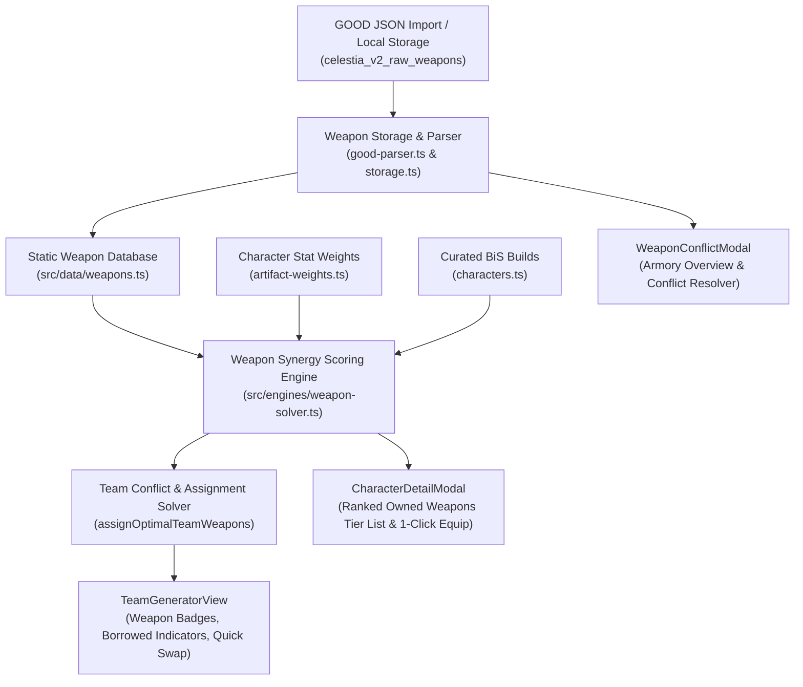

# Weapon Synergy Engine & Inventory Roster Matcher Plan

> **For agentic workers:** REQUIRED SUB-SKILL: Use superpowers:subagent-driven-development (recommended) or superpowers:executing-plans to implement this plan task-by-task. Steps use checkbox (`- [ ]`) syntax for tracking.

**Goal:** Implement a theorycraft-grade, 100% client-side **Weapon Synergy Engine & Inventory Roster Matcher**. The engine parses full weapon bags from GOOD JSON imports, tracks weapon levels & refinements (R1–R5), automatically solves team-optimal weapon assignments in `TeamGeneratorView` (resolving conflicts and highlighting borrowed weapons), provides a ranked "Best Owned Weapons" tier list in `CharacterDetailModal`, and adds an interactive Weapon Conflict Resolver & Manual Armory Editor.

**Tech Stack:** React 19, TypeScript 5.7, Tailwind CSS v4, Lucide React, Vitest.

---

## Architecture Overview

---

## Doubt-Driven Stress-Test & Mitigations

1. **Combinatorial Explosion ($O(W^4)$ across 500+ weapons):**
   - *Risk:* Checking all permutations of 4 team members with a 500-weapon inventory would cause $500^4 \approx 6.2 \times 10^{10}$ calculations and freeze the UI.
   - *Mitigation:* Prune weapon candidates strictly by `weaponType` match, filter out fodder (<3★ unless Thrilling Tales R5), take only top $K=5$ viable weapons per character, and solve optimal assignment via maximum bipartite matching / greedy delta pruning ($5^4 = 625$ iterations max, $< 1\text{ms}$).
2. **Duplicate Weapon Instances:**
   - *Risk:* A user can own multiple instances of the same weapon (e.g., two R5 Favonius Lances, one Lv90 and one Lv80).
   - *Mitigation:* Every `OwnedWeapon` receives a unique instance `id` (`${key}_${index}` during GOOD parse, or persistent UUID). Conflict resolution tracks instance IDs, not bare keys.
3. **Key Name Normalization:**
   - *Risk:* Discrepancies between GOOD PascalCase keys (`StaffOfHoma`) and theorycraft human strings (`Staff of Homa`).
   - *Mitigation:* Implement bidirectional mapping helpers with normalized canonical keys (`name.replace(/[^a-zA-Z0-9]/g, '').toLowerCase()`).
4. **Storage Quota & Backward Compatibility:**
   - *Risk:* Users upgrading from older Celestia v2 instances with no weapon bag stored.
   - *Mitigation:* Fallback gracefully: if `celestia_v2_raw_weapons` is empty, reconstruct weapon records from `OwnedCharacterProfile.weapon` and default starter builds. Wrap all `localStorage` writes in try/catch.

---

## Implementation Tasks

### Component 1: Types & Weapon Database
- [x] **Task 1.1: Extend type contracts in `src/types/genshin.ts`**
  Added `WeaponData`, `OwnedWeapon`, `WeaponScoreResult`, `TeamWeaponAssignment`, and extended `TeamRecommendation`.
- [x] **Task 1.2: Implement static database in `src/data/weapons.ts`**
  Curated 5★, 4★, and key 3★ weapons across all 5 weapon classes with base stats, sub-stats, passive tags, and canonical key resolution.

### Component 2: Storage & GOOD Parser Uplift
- [x] **Task 2.1: Update `src/services/good-parser.ts`**
  Extracts all weapons (equipped + bag) into `rawWeapons`, assigns unique instance IDs, handles ascension calculation (0–6), and implements safe `mergeWeapons`.
- [x] **Task 2.2: Update `src/services/storage.ts`**
  Implemented `getSavedWeapons()` and `saveWeapons()` under `celestia_v2_raw_weapons` with graceful starter roster fallbacks.

### Component 3: Synergy Scoring & Team Conflict Solver (TDD)
- [x] **Task 3.1: Write unit tests in `src/engines/weapon-solver.test.ts`**
  Covered single-character scoring, refinement scaling, duplicate-free team assignment, borrowing detection, and multi-weapon-deficit fallback synthesis (15 tests passing).
- [x] **Task 3.2: Implement `src/engines/weapon-solver.ts`**
  Implemented `scoreWeaponForCharacter`, `rankWeaponsForCharacter`, and `assignOptimalTeamWeapons` with greedy delta team optimization and DEF/HP kit inference.
- [x] **Task 3.3: Wire into `src/engines/team-generator.ts`**
  Connected `assignOptimalTeamWeapons` to dynamically populate `team.weaponAssignments`.

### Component 4: UI Integration & Conflict Resolver
- [x] **Task 4.1: Create `src/components/WeaponConflictModal.tsx`**
  Built full Armory management modal with All/Equipped/Bag tabs, conflict warnings, weapon editor, and manual creation.
- [x] **Task 4.2: Update `src/components/TeamGeneratorView.tsx`**
  Added weapon badges (refinement R1–R5, BiS/Optimal/Borrowed tags, borrowed source pill) and Quick Swap popover with teammate conflict resolution.
- [x] **Task 4.3: Update `src/components/CharacterDetailModal.tsx`**
  Added ranked Owned Weapons list with relative % scores and 1-click equip button, plus manual weapon customization.
- [x] **Task 4.4: Wire `App.tsx` and `Navbar.tsx`**
  Threaded weapon state, two-way roster-profile sync, and added "Armory" navigation button with weapon count.

---

## Verification Record

- **Vitest Unit Suite:** 10 test files, 118 unit tests passed (0 failures).
- **Production Build:** `tsc -b && vite build` passed with zero errors (`dist/assets/index-Q6Y-SnUd.js` 1,403 kB, `dist/assets/index-CvzkAUI_.css` 72 kB).
- **Code Review:** Cleaned up duplicate weapon cloning, state synchronization on bag unequip, and external scanner ascension compliance.
